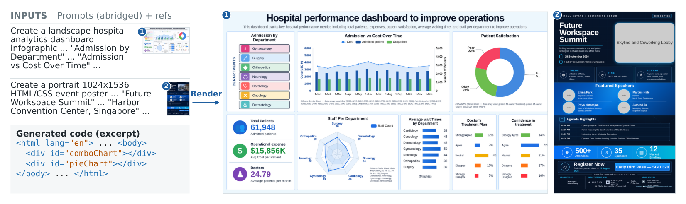
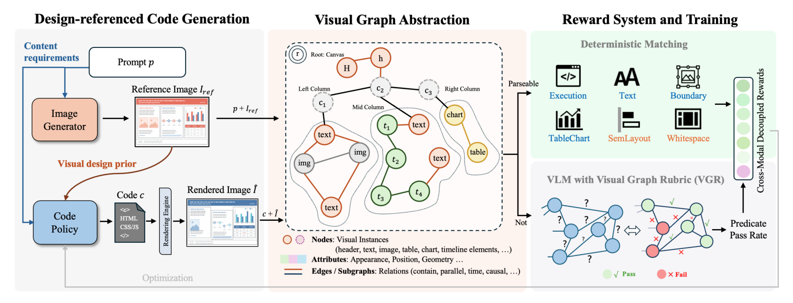
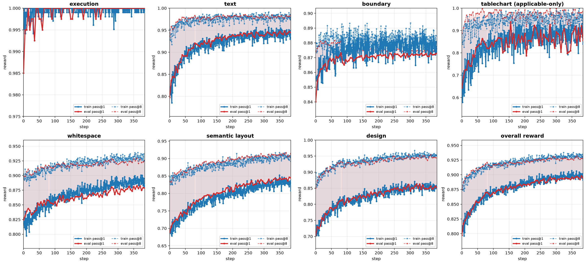

<div align="center">

# AesCode: Aesthetic Code Generation with Decoupled Cross-Modal Rewards

**Generating information-rich visual artifacts as editable, verifiable code, with image generators as a source of aesthetic guidance.**

[](https://arxiv.org/abs/2610.18860)
[](https://huggingface.co/papers/2610.18860)
[](https://microsoft.github.io/AesCode/)
[](https://huggingface.co/microsoft/AesCode-32B)
[](LICENSE)

</div>

<p align="center">
  
</p>

<p align="center"><em>Generated HTML/CSS rendered in a browser: a landscape dashboard and a portrait poster.</em></p>

## Overview

Information-rich visual artifacts such as slides, posters, and dashboards are attractive to generate as code because the outputs remain **structured, editable, and verifiable**. Yet code models **cannot see how their choices of layout, hierarchy, and color come together on the canvas**. They may satisfy the content requirements while still producing visually dated or poorly organized designs. Image generators have the opposite strength: they compose visually compelling pages, but often misrender text, numbers, and logical relationships.

AesCode introduces a setting in which **an image generated from the same prompt serves as aesthetic guidance** for the code model. **The prompt remains the source of truth for content**, while the reference supplies one possible layout and style.
Simply providing the reference as an input is not enough. Off-the-shelf vision-language models may copy its hallucinated content or ignore its layout. AesCode explicitly trains the model to separate semantic requirements from visual cues through **graph-structured supervision and decoupled cross-modal rewards**.

## How it works

<p align="center">
  
</p>

AesCode learns from the reference through three steps:

1. **Represent the target as a design graph.** Nodes describe text, charts, tables, cards, regions, and semantic image slots. Edges capture containment, alignment, order, and connection.
2. **Route each property to the right reward.** Six deterministic verifiers score execution, exact text, boundaries, table and chart data, semantic layout, and whitespace. A sample-specific Visual Graph Rubric evaluates the remaining visual properties with graph-bound yes/no questions. For photo and illustration slots, it checks geometry and placement rather than depicted content.
3. **Normalize rewards before combining them.** GDPO normalizes each channel within its rollout group so that dense rule rewards do not overwhelm sparse visual feedback.

This produces targeted supervision for correctness, spatial planning, and visual quality without reducing them to one unstable score.

<p align="center">
  
</p>

<p align="center"><em>Per-channel training curves under GDPO. Solid lines show pass@1; dashed lines show pass@8. Blue denotes training prompts and red denotes held-out prompts.</em></p>

Execution saturates after cold-start SFT, while Text and Table/Chart improve quickly. Semantic Layout, Whitespace, and Design continue rising throughout training. The close training and held-out curves show no visible reward trade-off or overfitting.

## Results

We evaluate on 300 infographic samples. `Rule` averages the programmatic Text, Bound, and Chart checks. `Visual` averages the Content, Layout, and Style checklist dimensions. `Overall` is the mean of Rule and Visual. Scores are percentages averaged over three generations per prompt with no selection.

`Ref.` indicates whether the model receives an image-generated reference together with the prompt. **Bold** marks the best score in each column and <u>underline</u> the second best.

| Model | Ref. | Text | Bound | Chart | Rule | Content | Layout | Style | Visual | Overall |
|---|:---:|---:|---:|---:|---:|---:|---:|---:|---:|---:|
| GPT-5.5 | No | 88.67 | 86.18 | 82.85 | 85.90 | 79.27 | 68.09 | 52.80 | 66.72 | 76.31 |
| GPT-5.5 | Yes | 89.22 | 86.85 | 81.35 | 85.80 | 82.44 | <u>89.93</u> | **57.91** | 76.76 | 81.28 |
| Claude Opus 4.8 | No | 91.40 | 85.03 | 87.69 | 88.04 | 84.98 | 64.88 | 46.72 | 65.53 | 76.78 |
| Claude Opus 4.8 | Yes | 92.45 | 84.43 | 73.75 | 83.55 | **86.42** | 89.76 | 55.51 | <u>77.23</u> | 80.39 |
| Qwen3-VL-8B | No | 58.32 | 77.23 | 43.30 | 59.61 | 38.33 | 23.97 | 13.22 | 25.17 | 42.39 |
| Qwen3-VL-8B | Yes | 64.07 | 70.99 | 42.35 | 59.14 | 52.90 | 51.33 | 29.92 | 44.72 | 51.93 |
| Qwen3-VL-32B | No | 66.00 | 80.31 | 41.36 | 62.55 | 49.81 | 34.85 | 19.34 | 34.67 | 48.61 |
| Qwen3-VL-32B | Yes | 71.19 | 79.61 | 50.77 | 67.19 | 62.04 | 64.59 | 38.43 | 55.02 | 61.10 |
| **AesCode-8B** | **Yes** | <u>94.06</u> | <u>88.36</u> | <u>87.79</u> | <u>90.07</u> | <u>86.41</u> | 87.80 | 53.21 | 75.80 | <u>82.94</u> |
| **AesCode-32B** | **Yes** | **95.34** | **97.27** | **90.37** | **94.33** | 85.76 | **90.58** | <u>55.99</u> | **77.44** | **85.89** |

### What the paper shows

- **Generated images can teach design without becoming ground truth.** Reference images improve visual presentation across the tested model families, while prompt-grounded rewards prevent their content errors from becoming supervision targets.
- **The visual prior becomes policy knowledge.** Removing the reference only at inference lowers AesCode-8B Visual by 1.0 point, compared with 19.6 points for its backbone. Even when the policy never sees references, reference-based rewards raise prompt-only Visual from 25.17 to 69.71.
- **Visual feedback works best when it is attributable.** Graph-bound rubric questions outperform both holistic VLM scoring and direct rubric authoring. Per-channel normalization adds a further 5.12 Visual points over scalar GRPO.
- **The gains transfer beyond the training benchmark.** AesCode-32B improves on its Qwen3-VL-32B backbone across all 14 reported measures on GDB/lica, SlidesBench, and Design2Code, with the largest gains on design-sensitive metrics.

## Models

| Model | Backbone | Checkpoint |
|---|---|---|
| AesCode-8B | [Qwen3-VL-8B](https://huggingface.co/Qwen/Qwen3-VL-8B-Instruct) | [🤗 AesCode-8B](https://huggingface.co/microsoft/AesCode-8B) |
| AesCode-32B | [Qwen3-VL-32B](https://huggingface.co/Qwen/Qwen3-VL-32B-Instruct) | [🤗 AesCode-32B](https://huggingface.co/microsoft/AesCode-32B) |

## 1. Environment setup

The released runs used Python 3.10, CUDA 12.6, and one node with 8 NVIDIA B200 GPUs.

```bash
git clone https://github.com/microsoft/AesCode.git
cd AesCode
pip install -r requirements.txt
cp .env.example .env
```

### Rendering and OCR

Every score is computed from a browser rendering. Both components below are required:

```bash
playwright install --with-deps chromium   # needs sudo on Debian/Ubuntu
pip install paddlepaddle==3.3.1 paddleocr==2.10.0

# minimal images also need the text-shaping stack and a font with wide coverage
apt-get install -y libpango-1.0-0 libpangocairo-1.0-0 libpangoft2-1.0-0 \
                   libfribidi0 libthai0 libdatrie1 fonts-noto
```

`--with-deps` installs Chromium's system libraries. Without them, the browser fails at launch and pages score zero. Run as a non-root user because Chromium refuses to start its sandbox as root, a common container failure.

PaddleOCR is pinned because version 3.x changes the constructor. The layout channel uses it to match text blocks between each reference and rendering. If PaddleOCR is missing, the channel returns zero instead of abstaining, silently corrupting the reward. Before a distributed run, download the weights once with `python -m verifier.cli.prewarm_ocr_cache --image-dir <dir>`.

ECharts is vendored and served locally. Allowed CDN assets are cached under `CDN_CACHE_DIR`; prewarm this cache on a connected machine for nodes without egress.

### verl (training only)

Training requires `verl` at the pinned commit below, with the included patch. **The patch is required:** the stock release does not support Qwen3-VL or the configuration used by the RL launcher.

```bash
pip install "verl @ git+https://github.com/volcengine/verl.git@4b9c14f2c306d43f84eccf47315323e3f1ce1270"
bash verl_patches/apply_verl_patch.sh "$(python -c 'import verl, pathlib; print(pathlib.Path(verl.__file__).parent)')"
```

The patch adds Qwen3-VL support, fixes a multi-rollout agent-loop deadlock, records per-channel GDPO metrics with applicability masks, and updates compatibility with newer `trl` and `transformers`. It applies only to the pinned commit; the script stops if any hunk fails.

### Credentials

Hosted stages read credentials from `.env` in the repository root. The launchers load it automatically, and Git ignores it.

```bash
cp .env.example .env
```

| Variable | What it is |
| --- | --- |
| `OPENAI_BASE_URL`, `OPENAI_API_KEY` | One OpenAI-compatible endpoint, shared by every hosted call |
| `VLM_MODEL` | Vision model: builds rubrics, judges renderings, recovers generation prompts |
| `IMAGE_MODEL` | Image model: drafts reference images |
| `AESCODE_BASE_URL`, `AESCODE_API_KEY` | A served AesCode checkpoint |

The OpenAI-compatible endpoint may be a hosted API, Azure OpenAI, or a self-hosted vLLM server.

## 2. Repository structure

```text
AesCode/
├── spec/          prompt and verifiable requirement construction
├── verifier/      rendering sandbox and deterministic reward channels
├── data_prep/     design graphs, rubrics, checklists, and dataset packing
├── sft/           supervised fine-tuning
├── rl_verl/       GDPO training and visual reward integration
├── inference/     local and API generation, and the one-line idea pipeline
├── eval/          reference-free evaluation pipeline
├── examples/      one complete input pair: prompt, requirements, reference image
├── tests/         aggregation and checklist contract tests
└── verl_patches/  required changes to the pinned verl version
```

## 3. Data format

This repository ships code, not datasets. Each sample contains a `generation_prompt`, a list of `verifiable_requirements`, and a reference image. See `examples/hospital_dashboard/sample.jsonl` for a complete record.

The released models were trained on 3,000 SFT demonstrations and 7,408 RL prompts, with 300 held-out prompts scored during RL.

```text
dataset/
├── images/                     reference PNGs, one per sample: <id>.png
├── html/                       target HTML for SFT, id-matched to the jsonl
├── split_sft.jsonl             SFT split
├── split_rl.jsonl              RL split
├── split_val.jsonl             held-out prompts scored during RL
└── rubrics.jsonl               Visual Graph Rubrics, joined to the RL splits by id
```

Each line is one sample, joined to `images/<id>.png` by `id`:

```jsonc
{
  "id": "train_10721",
  "generation_prompt": "Create a landscape hospital analytics dashboard infographic titled ...",
  "reference_metadata": {"reference_image_wh": "1280x720", "reference_orientation": "landscape"},
  "verifiable_requirements": [ /* below */ ]
}
```

`generation_prompt` carries everything the model is asked to produce. Every requirement has an `id`, a `category`, and an `expected` payload whose shape is set by the channel that consumes it:

```jsonc
// text channel: a string that must appear in the rendering
{"id": "req_title", "category": "text_exact",
 "expected": {"text": "Hospital performance dashboard to improve operations",
              "normalization": "cjk_basic"}}

// tablechart channel, chart: subtype plus the literal series, either named
// segments or a flat list of numbers
{"id": "req_pie_chart_data", "category": "chart_data",
 "target": {"chart_type": "echarts", "chart_subtype": "pie"},
 "expected": {"data": [{"name": "Excellent", "value": 53}, {"name": "Okay", "value": 25},
                       {"name": "Poor", "value": 22}]}}

{"id": "req_radar_staff", "category": "chart_data",
 "target": {"chart_type": "echarts", "chart_subtype": "radar"},
 "expected": {"data": [30, 28, 22, 34, 26, 24, 20]}}

// tablechart channel, table: header row followed by data rows
{"id": "req_wait_table", "category": "table_data",
 "expected": {"data": [["Department", "Wait time"], ["Cardiology", "38"],
                       ["Concology", "45"], ["Dermatology", "42"]]}}
```

### Visual Graph Rubrics

The rubric is a separate file, not a second copy of the split. `data_prep.build_vgr` reads `split_rl.jsonl` and writes one row per sample, keyed by the same `id`:

```jsonc
{"id": "train_10721",
 "design_graph": {"layout_class": "symmetric_grid", "skeleton": [ /* ... */ ],
                  "graph": {"nodes": [ /* ... */ ], "edges": [ /* ... */ ]}},
 "rubric_questions": [ /* below */ ],
 "vgr_lint": {"flags": [], "bound_to_own_graph": 1.0}}
```

`rl_verl.data_prep --rubric-input` joins the two by `id` when it builds the training parquet, so a rubric can be rebuilt, audited, or swapped without touching the split. The design reward is the pass rate over `rubric_questions`, answered from the candidate rendering alone.

Each question binds to an element of that sample's graph and declares the answer that counts as a pass. Questions quantify over a whole set wherever the graph gives one, because a question about a single element is passed by almost every attempt and tells the reward nothing:

```jsonc
{"id": "q3", "binds_to": "subgraph:metric_total,metric_expense,metric_doctors", "qtype": "structure",
 "question": "Are all three metric blocks stacked in one column with their left edges aligned?",
 "pass_answer": "yes"}

{"id": "q8", "binds_to": "node:wait_times_list", "qtype": "completeness",
 "question": "Is every department name in the wait-times list on a single line, neither wrapped nor cut off by its bar?",
 "pass_answer": "yes"}

{"id": "q11", "binds_to": "global:page", "qtype": "forbidden",
 "question": "Are there more than three metric blocks in the summary section?",
 "pass_answer": "no"}

{"id": "q14", "binds_to": "global:page", "qtype": "global",
 "question": "Is the page free of unintended overlap or occlusion between elements?",
 "pass_answer": "yes"}
```

Questions never ask what a string says or what an image depicts; the text and OCR channels already score those, and the reference generator may legitimately draw a different picture in the same slot.

## 4. Training

### Build Visual Graph Rubrics

```bash
python -m data_prep.build_vgr \
  --input dataset/split_rl.jsonl \
  --output dataset/rubrics.jsonl \
  --image-dir dataset/images \
  --concurrency 16
```

Rubric construction uses two model calls: one extracts a design graph from the prompt and reference, and the other writes 10 to 20 graph-bound yes/no questions. A linter checks bindings, polarity, atomicity, and coverage.

### Build the training parquet

```bash
python -m rl_verl.data_prep \
  --input dataset/split_rl.jsonl \
  --val-input dataset/split_val.jsonl \
  --rubric-input dataset/rubrics.jsonl \
  --image-dir dataset/images \
  --output-dir dataset/
```

This is where the rubric is joined onto the split, for both training and validation prompts. `--rubric-input` also accepts a directory of `<id>.json` files if you prefer one rubric per file, and `--val-rubric-input` takes a separate file for the val split.

### Run SFT and GDPO

```bash
bash sft/train_sft.sh
bash rl_verl/train_32b.sh
# or
bash rl_verl/train_8b.sh
```

Point `MODEL` in the RL launcher to the SFT checkpoint. The released 8B and 32B checkpoints were selected at steps 400 and 520. Both use the same 7,408 RL prompts and all seven reward channels. The launchers require the patched `verl` installation from the setup section.

## 5. Using a trained model

### Serve a checkpoint

```bash
vllm serve microsoft/AesCode-32B \
  --port 8000 \
  --tensor-parallel-size 4 \
  --limit-mm-per-prompt image=2
```

The examples below use AesCode-32B. Substitute `microsoft/AesCode-8B` to run the smaller model; no other argument changes.

### Run an example

`examples/hospital_dashboard/` contains a complete input pair for a hospital analytics dashboard. `sample.jsonl` holds the prompt and its 11 exact-text, 5 chart-data, and 1 table-data requirements; `reference.png` holds the reference image.

```bash
python -m inference.generate \
  --provider openai \
  --model microsoft/AesCode-32B \
  --base-url http://127.0.0.1:8000/v1 \
  --spec-file examples/hospital_dashboard/sample.jsonl \
  --image examples/hospital_dashboard/reference.png \
  --out page.html
```

`--spec-file` applies the canvas and reference template used during training and inlines the chart and table data contracts. Use `--prompt-file` to send a prompt verbatim. The module also supports downloaded weights with `--provider local` and hosted models with `--provider anthropic`. It writes a self-contained `page.html`.

### Start from an idea

`inference.from_idea` turns a short idea into the detailed prompt and reference pair that AesCode expects. An **image model** drafts the reference, then a **vision model** expands the idea into a generation prompt with text, chart, and table requirements. Both use the endpoint configured in [Credentials](#credentials); our runs used GPT-Image-2 and GPT-5.5.

```bash
IDEA="A quarterly sales dashboard for a European EV brand. Show revenue and \
units delivered for the last four quarters, a regional breakdown across \
Germany, France, Norway and the Netherlands, and a table of the top five \
models. Keep it clean and corporate, dark text on a light background."

python -m inference.from_idea \
  --idea "$IDEA" \
  --orientation landscape \
  --outdir out/ \
  --skip-generate
```

This writes `reference.png`, `spec.json`, and `preview.txt`. The drafted image supplies the layout; you supply the facts. Edit `out/spec.json` before generation: `generation_prompt` holds the page copy, and each requirement's `expected.data` holds the chart and table values. Then generate from the corrected spec with the same reference image:

```bash
python -m inference.from_idea \
  --spec-file out/spec.json \
  --outdir out/ \
  --model microsoft/AesCode-32B \
  --base-url http://127.0.0.1:8000/v1
```

Keep the prompt and requirements consistent. A `text_exact` requirement is retained only when its string appears verbatim in `generation_prompt`. On resume, the pipeline validates the edited file, reports anything it drops, and rewrites `preview.txt` with the exact model input.

The code model is configured separately. By default, the pipeline uses a served AesCode checkpoint. Use `--provider anthropic` or a hosted `--base-url` and `--model` pair to run another model. Pass `--reference-image` to provide your own reference and skip image drafting.

## Citation

```bibtex
@article{gao2026aescode,
  title   = {AesCode: Aesthetic Code Generation with Decoupled Cross-Modal Rewards},
  author  = {Gao, Xin and Yang, Yifan and Li, Xin and Wang, Pan and Li, Yan and Tian, Muzhao and Cheng, Mingxi and Liu, Bei and Qiu, Kai and Dai, Qi and Chen, Dong and Dong, Yue and Tassiulas, Leandros and Ying, Rex and Li, Ji and Luo, Chong},
  journal = {arXiv preprint arXiv:2610.18860},
  year    = {2026}
}
```

## Acknowledgements

AesCode builds on [verl](https://github.com/volcengine/verl), [GDPO](https://arxiv.org/abs/2601.05242), and [Qwen3-VL](https://github.com/QwenLM/Qwen3-VL).

## License

Code is released under the [MIT License](LICENSE). Model checkpoints follow the license of their Qwen3-VL backbone.
