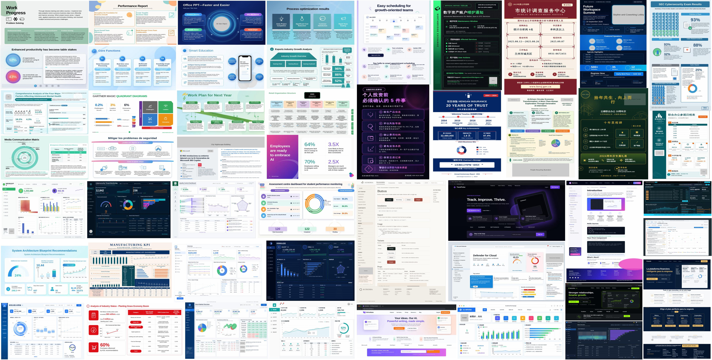

# DesignCoder



DesignCoder generates complex infographics—slides, posters, dashboards, and
webpages—with code, and trains open vision-language models to do this well.
Because infographics demand both visual design competence and factual precision,
neither image generators (strong in layout and typography, but weak at dense text
and structural accuracy) nor code models (rigorous and executable, but weaker at
visual organization) suffice alone. Instead of trading one for the other,
DesignCoder **integrates the image generator into the code-generation
pipeline**: a generated reference image acts as a *design anchor* to externalize
visual priors like layout and color, while the code model learns to realize them
in executable code without treating the reference as a direct reconstruction
target. Supervision is factorized into **decoupled, multi-dimensional rewards**:
six deterministic validators verify measurable properties (e.g., execution, text,
layout, whitespace), and a *Visual Graph Rubric* grounds VLM judgments of
perceptual quality in the reference. Training combines supervised fine-tuning
with reinforcement learning (*GDPO*), keeping each reward channel's signal
separate.

This repository contains the training and evaluation code:

```text
DesignCoder/
├── inference/       # HTML generation (prompts, providers, batch client)
├── verifier/        # the reward system: 7-dimension render + score
├── rl_verl/         # GDPO RL training (verl backend) + reward bridge
├── sft/             # supervised fine-tuning (DeepSpeed ZeRO-3)
├── eval/            # release evaluation (inference + validation) + demo
├── scripts/         # SFT launcher
├── verl_patches/    # patches applied on top of the upstream `verl` package
├── requirements.txt # pinned, known-good dependency set
└── .env.example     # credential template (copy to .env)
```

---

## 1. Environment setup

Reference environment: **Python 3.10, CUDA 12.x**, a node with 8 GPUs (the
released numbers use 8×B200-183GB; the code runs on smaller GPUs with the
adjustments noted in the training section).

```bash
# 1. Create an environment and install pinned deps
python3.10 -m venv .venv && source .venv/bin/activate
pip install -r requirements.txt

# 2. verl is installed from a local worktree, then patched:
git clone https://github.com/volcengine/verl.git && cd verl && pip install -e . && cd ..
bash verl_patches/apply_verl_patch.sh /path/to/site-packages/verl

# 3. flash-attn needs --no-build-isolation:
pip install flash-attn==2.8.3 --no-build-isolation

# 4. Install the Chromium the verifier renders with, plus its system libs:
playwright install chromium
# Minimal images also need the pango/fribidi/thai/datrie stack:
#   apt-get install -y libpango-1.0-0 libpangocairo-1.0-0 libpangoft2-1.0-0 \
#                      libfribidi0 libthai0 libdatrie1 fonts-noto
```

`requirements.txt` pins the exact known-good versions (torch 2.10, transformers
4.57, vllm 0.17, ray 2.54, deepspeed 0.18, etc.). Upgrade deliberately and
re-test the RL stack end-to-end.

### Credentials (`.env`)

Several components call hosted models and read credentials from a `.env` file in
the repo root (auto-loaded by the launchers and scripts). Copy the template and
fill in what you need:

```bash
cp .env.example .env
```

| Used by | Keys |
| --- | --- |
| Design reward (VLM rubric judge) during RL | `VLM_REWARD_BASE_URL`, `VLM_REWARD_API_KEY`, `VLM_REWARD_MODEL` |
| Eval Design judge (`eval/run_validation.py`) | `JUDGE_BASE_URL`, `JUDGE_API_KEY`, `JUDGE_MODEL` |
| Demo image generation (`eval/demo_generate.py`) | `GOOGLE_NANO_BANANA` (Gemini) or OpenAI creds |

Any OpenAI-compatible endpoint works for the reward/judge (hosted API, Azure
OpenAI, or a self-hosted vLLM server). Never commit `.env` — it is gitignored.

---

## 2. Data format

DesignCoder ships **code only, no datasets**. A training sample is a
`generation_prompt` + `verifiable_requirements` + a reference image, plus an
optional per-sample `rubric` for the design dimension. Expected data root layout:

```text
<data_root>/
├── images/                # reference PNGs, one per sample: <id>.png
├── refine_html_aug_v1/    # target HTML for SFT (id-matched to the jsonl)
├── cot_generate/          # optional chain-of-thought targets (<id>.json)
├── split_sft_*.jsonl      # SFT split
├── split_rl_*.jsonl       # RL train split
├── split_eval_*.jsonl     # eval split
├── rl_rubrics/            # RL rubrics: one JSON per sample, <id>.json
└── eval_rubrics/          # eval rubrics: one JSON per sample, <id>.json
```

Each split line is one sample, joined to `images/<id>.png` and its rubric by `id`:

```jsonc
{
  "id": "sample_0001",
  "generation_prompt": "Design a light-theme landscape infographic ...",
  "verifiable_requirements": [ /* see below */ ],
  "reference_metadata": {"reference_image_wh": "1280x720", "reference_orientation": "landscape"}
}
```

`verifiable_requirements` — each has an `id`, `category`, and an `expected`
payload whose shape depends on the validator that consumes it:

```jsonc
// Text validator — exact string that must appear in the render:
{"id": "req_title", "category": "text_exact", "expected": {"text": "Global needs in the cloud"}}

// TableChart validator, chart — chart type (in `target`) + numeric series:
{"id": "req_chart", "category": "chart_data",
 "target": {"chart_type": "echarts", "chart_subtype": "bar"},
 "expected": {"data": [3.0, 0.972, 0.598]}}

// TableChart validator, table — full 2-D table (header row + data rows):
{"id": "req_table", "category": "table_data",
 "expected": {"data": [["Pricing", "Monthly", "Hourly"], ["Standard", "$73", "$0.100"]]}}
```

**Rubrics** (yes/no questions the Design judge grounds on) are stored the same
way for both stages: **one JSON file per sample**, `<rubric_dir>/<id>.json`, each
containing a `rubric` list. You author the questions once per sample and point
each stage at its own rubric directory:

```jsonc
// <rubric_dir>/sample_0001.json
{"id": "sample_0001",
 "rubric": [{"question": "Is the title shown at the top center?", "expected": "yes"}]}
```

- **RL training**: pass the rubric directory to `rl_verl.data_prep` via
  `--rubric-input <rl_rubrics_dir>`; the questions are baked into the parquet and
  read at reward time by `RubricDesignScorer`.
- **Evaluation**: pass the rubric directory to `eval/run_validation.py` via
  `--rubric-dir <eval_rubrics_dir>` (or the `RUBRIC_DIR` env var).

Both stages accept a directory of `<id>.json` files, so the same rubric set works
for either — keep separate `rl_rubrics/` and `eval_rubrics/` directories if your
train and eval splits differ.

---

## 3. Training

Two stages: SFT warm start, then GDPO reinforcement learning. **All launcher
defaults (batch sizes, offload flags, GPU-memory fraction, TP size) are tuned
for 8×B200 and are environment-overridable — adjust them for your hardware.**

### SFT

Single-stage mixed training (learns *generate* and *refine* jointly) with
DeepSpeed ZeRO-3. Point the launcher at your data root, base model, and output
dir via env vars:

```bash
SFT_DATA_ROOT=<data_root> \
MODEL_NAME=<base-model-or-hf-ckpt> \
REFINE_DIR=<data_root>/refine_html_aug_v1 \
COT_GENERATE_DIR=<data_root>/cot_generate \
DS_CONFIG=sft/configs/ds_zero3_no_offload.json \
OUTPUT_DIR=<out>/sft_run \
bash scripts/run_sft.sh
```

On 8×B200, 32B ZeRO-3 runs without offload (~134/183 GB peak). On smaller GPUs
switch to `sft/configs/ds_zero3.json` (offload enabled).

### GDPO RL

RL uses Ray + FSDP (actor) + vLLM (rollout). First prepare the parquet data,
start a Ray cluster, then launch. Four launchers cover **8B / 32B × single /
multi node**; each is a thin wrapper over the engine `rl_verl/run_gdpo.sh`:

```bash
# 1. Convert your RL jsonl to parquet:
python -m rl_verl.data_prep \
  --input <data_root>/split_rl_train.jsonl \
  --val-input <data_root>/split_eval.jsonl \
  --rubric-input <data_root>/rl_rubrics \
  --image-dir <data_root>/images \
  --output-dir dataset/

# 2. Start Ray (single node):
ray start --head --num-gpus=8 --num-cpus=48 --disable-usage-stats

# 3. Launch (single node, 8B):
MODEL=/path/to/sft_8b bash rl_verl/launch_8b_single_node.sh
```

| Launcher | Model | Topology |
| --- | --- | --- |
| `rl_verl/launch_8b_single_node.sh`  | 8B  | 1 node × 8 GPUs |
| `rl_verl/launch_8b_multi_node.sh`   | 8B  | N nodes (set `NNODES`) |
| `rl_verl/launch_32b_single_node.sh` | 32B | 1 node × 8 GPUs |
| `rl_verl/launch_32b_multi_node.sh`  | 32B | N nodes (set `NNODES`) |

The 32B launchers lower `GPU_MEM_UTIL` and the log-prob micro-batches to avoid
vLLM wake-up OOM; the multi-node launchers assume a Ray cluster already spans all
nodes (`ray start --address=<HEAD_IP>:6379` on workers) and that you launch on
the head node. Every hyperparameter has an env-overridable default at the top of
`run_gdpo.sh` — read that header before your first run. Use `--debug` for a
small-batch smoke run.

Reward configuration (dimensions, weights, VLM-judge timeouts, checkpoint
retention) is set as env vars in `run_gdpo.sh`; the design dimension needs the
`VLM_REWARD_*` credentials from `.env`.

---

## 4. Using a trained model

### Evaluation

`eval/` provides a two-stage release evaluation that runs on one node:

```bash
# deterministic 6 dimensions only:
bash eval/run_eval.sh /path/to/checkpoint ./runs/my_model \
    <data_root>/eval.jsonl <data_root>/images 8 8 8

# with the Design dimension (any OpenAI-compatible vision endpoint + rubrics):
export JUDGE_BASE_URL=... JUDGE_API_KEY=... JUDGE_MODEL=gpt-4o RUBRIC_DIR=<data_root>/eval_rubrics
bash eval/run_eval.sh /path/to/checkpoint ./runs/my_model \
    <data_root>/eval.jsonl <data_root>/images 8 8 8
```

`run_inference.py` serves the checkpoint with vLLM and rolls out N generations
per spec; `run_validation.py` scores them and prints a pa@1 / pa@N table. See
[`eval/README.md`](eval/README.md) for the scoring protocol, per-stage usage, and
outputs.

### Try-it demo

Turn a free-form idea into a rendered design without any dataset:

```bash
python eval/demo_generate.py \
  --idea "A dark-mode weather dashboard: big current-temperature panel on the
          left, a 5-day forecast strip along the bottom, and an hourly line
          chart on the right (hours 00-12 with values 8, 7, 7, 9, 12, 15, 17,
          18, 16, 14, 11, 9 °C). Cool blue palette." \
  --out demo_out/ --image-provider gemini
```

**Tip:** if your design contains a chart or a table, include the actual data in
the idea (the numeric series, or the table rows/columns). DesignCoder was trained
on samples whose prompts carry concrete data, so supplying real numbers keeps the
input in-distribution and yields a design that renders your data faithfully
rather than inventing placeholder values.

Stages: idea → synthetic **reference image** → detailed **generation prompt** →
standalone **HTML** → placeholders filled with real images. The reference-image
step concretizes the user's intent (a short user prompt is not shaped like the
long, structured prompts the model trained on), so the code model receives an
in-distribution input that still reflects what was asked. To run stage 3 against
your own trained DesignCoder model instead of a hosted VLM, serve it with any
OpenAI-compatible server (e.g. `vllm serve <ckpt> --served-model-name designcoder`),
set the `VLLM_*` vars in `.env`, and pass `--provider vllm`. Requires the
image-model and Azure OpenAI keys in `.env`.
